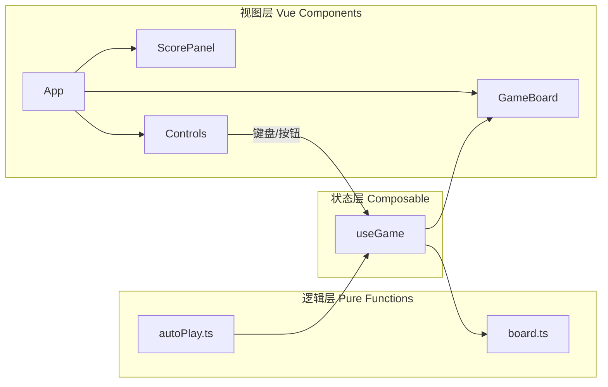

# 适合新手的第一个前端项目：2048游戏

## 项目概览

### 技术栈

| 类别 | 选型 | 说明 |
| :--- | :--- | :--- |
| 框架 | Vue 3 | Composition API（`<script setup>`） |
| 语言 | TypeScript | 类型约束棋盘、方向、移动结果等核心数据结构 |
| 构建 | Vite 8 | 本地开发热更新、生产构建 |
| 持久化 | `localStorage` | 保存历史最高分 |

常用命令：

```bash
npm run dev      # 启动开发服务器
npm run build    # 类型检查 + 生产构建
npm run preview  # 预览构建结果
```

---

### 项目结构

当前仓库采用「逻辑与界面分离」的目录布局，核心代码集中在 `src/game` 与 `src/composables`：

```
2048game/
├── index.html              # 页面入口
├── vite.config.ts          # Vite 配置
├── package.json
├── tsconfig*.json          # TypeScript 配置
├── public/                 # 静态资源
└── src/
    ├── main.ts             # Vue 应用挂载
    ├── App.vue             # 根组件：布局 + 键盘监听
    ├── style.css           # 全局样式
    ├── assets/             # 图片等资源
    ├── game/               # 【纯逻辑层】不依赖 Vue、不操作 DOM
    │   ├── types.ts        # 类型定义（Cell、Board、Direction 等）
    │   ├── board.ts        # 棋盘规则：移动、合并、生成、胜负判定
    │   └── autoPlay.ts     # （规划中）启发式自动算法
    ├── composables/        # 【状态层】Vue 可复用逻辑
    │   └── useGame.ts      # 游戏状态管理：board、score、move、reset
    └── components/         # 【视图层】
        ├── GameBoard.vue   # （规划中）4×4 棋盘渲染
        ├── ScorePanel.vue  # （规划中）当前分 / 最高分
        └── Controls.vue    # （规划中）新游戏、自动开/停、速度
```

**当前进度（截至文档编写时）：**

- 已完成：Vite + Vue3 + TS 环境搭建；`types.ts` 类型定义；`board.ts` 核心逻辑；`useGame.ts` 状态管理与 UI 组件；键盘操控接入、样式与胜负提示；
- 进行中：界面美观度优化，动画效果。
- 待实现：`autoPlay.ts`、

---

### 设计思路

#### 1. 三层架构：逻辑 → 状态 → 视图

项目 deliberately 拆成三层，避免「所有代码都写在 `.vue` 里」的常见新手陷阱：



| 层级 | 文件 | 职责 | 原则 |
| :--- | :--- | :--- | :--- |
| 逻辑层 | `board.ts` | 滑动、合并、随机生成、能否移动、是否胜利 | **纯函数**：入参 → 出参，不改外部状态 |
| 状态层 | `useGame.ts` | 持有 `ref` 响应式数据，调用 `board.ts`，暴露 `move` / `reset` | 连接逻辑与界面 |
| 视图层 | `*.vue` | 渲染棋盘、分数、按钮；监听键盘 | 只展示与交互，不写合并算法 |

#### 2. 为什么 `board.ts` 必须是纯函数？

2048 的移动规则（压紧 → 合并 → 再压紧）与 UI 无关。把它写成纯函数有三个好处：

1. **调试简单**：给定一个棋盘数组，直接在控制台调用 `move(board, 'left')` 即可验证
2. **自动算法友好**：AI 可以对四个方向分别「假移动」并评分，不影响真实棋盘
3. **可测试**：后续可为 `board.ts` 写单元测试，无需启动浏览器

`move()` 返回统一的 `MoveResult`：

```ts
{
  board: Board        // 移动后的新棋盘
  scoreGained: number // 本次合并得分
  moved: boolean      // 是否有效移动（false 则不生成新砖）
}
```

#### 3. 键盘与界面如何响应？

数据流是单向的，理解这条链路就能掌握整个项目：

```
用户按 ↑
  → App.vue 监听 keydown，映射为 move('up')
    → useGame.move() 调用 board.move()
      → 更新 board.value、score.value
        → GameBoard 绑定 :board="board"
          → Vue 自动重绘格子
```

要点：

- **键盘监听放在 `App.vue`**，不放在 `board.ts` 或 `useGame.ts`
- **无效移动**（`moved === false`）直接 return，界面不变，也不生成新砖
- **自动模式**开启时，忽略手动方向键，避免人与 AI 争抢输入

#### 4. 自动算法（规划）

`autoPlay.ts` 采用启发式评分，而非完整 Expectimax 树搜索，在浏览器中足够流畅：

1. 对四个合法方向分别模拟一步
2. 用评分函数比较：空格数、最大砖是否在角落、行列单调性、合并潜力
3. 选最高分方向，通过 `setInterval` 定时调用 `useGame.move()`

---

### 工作流

推荐按以下顺序逐步实现，每一步都能独立运行或验证：

| 阶段 | 任务 | 产出 | 验证方式 |
| :---: | :--- | :--- | :--- |
| 1 | 环境搭建 | Vite + Vue3 + TS | `npm run dev` 能打开页面 |
| 2 | 类型定义 | `types.ts` | TypeScript 无报错 |
| 3 | 棋盘逻辑 | `board.ts` | 控制台手动调用 `move()` 检查结果 |
| 4 | 状态管理 | `useGame.ts` | `ref` 更新后数据正确变化 |
| 5 | 棋盘 UI | `GameBoard.vue` | 页面显示 4×4 格子与数字 |
| 6 | 键盘操控 | `App.vue` keydown | 方向键能驱动棋盘变化 |
| 7 | 分数与持久化 | `ScorePanel.vue` + localStorage | 合并加分、刷新后最高分保留 |
| 8 | 控制面板 | `Controls.vue` | 新游戏、胜负提示 |
| 9 | 自动算法 | `autoPlay.ts` | 一键自动对局至无法移动 |
| 10 | 样式打磨 | `game.css` | 经典 2048 配色、响应式布局 |

**日常开发循环：**

```bash
# 1. 启动开发服务器
npm run dev

# 2. 修改 src/ 下对应文件，浏览器热更新

# 3. 提交前做类型检查与构建
npm run build
```

**模块依赖关系（实现顺序建议）：**

```
types.ts
   ↓
board.ts ──→ autoPlay.ts
   ↓
useGame.ts
   ↓
App.vue + GameBoard + ScorePanel + Controls
```

先写 `board.ts`，再写 `useGame.ts`，最后接 UI 与键盘——自底向上，每一层只依赖下一层，不会出现「界面写了但逻辑还没定」的返工。

---

### 核心玩法规则（实现对照）

实现 `board.ts` 时需严格遵守以下规则，与原版 2048 一致：

1. **移动**：按方向压紧 → 相邻相同数字合并（每格每回合最多合并一次）→ 再压紧
2. **生成**：仅当 `moved === true` 时，在随机空格放置 `2`（90%）或 `4`（10%）
3. **胜利**：任意格子出现 `2048`；通常允许继续游戏
4. **失败**：无空格且四个方向均无法产生有效移动

## 项目内容
### types.ts

在这个文件里声明了整个项目的一些接口。如：
1. 什么是方格（`Cell = number`，什么是棋盘`Board = Cell[][]`。
2. 定义四个方向 `type Direction = 'up' | 'down' | 'left' | 'right';`
3. 定义游戏状态 `type GameStatus = 'playing' | 'won' | 'lost';`。